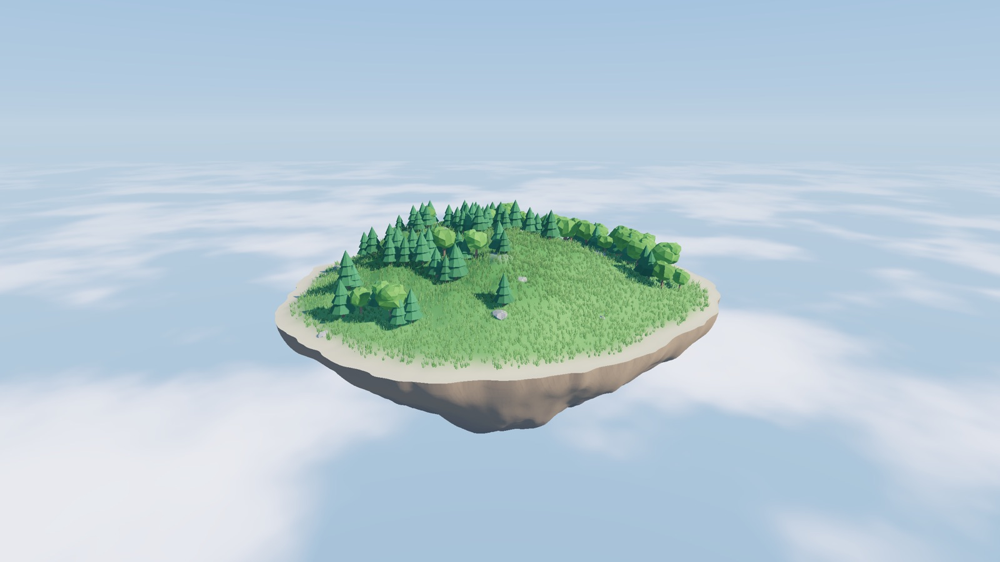

# 《浮岛》Vulkan 自研渲染器

一个从零实现的 Vulkan 1.3 渲染器，用一座浮空岛场景（实例化植被、云海、昼夜循环、基于天空的环境光照）验证渲染框架与性能优化。



## 技术栈

- C++17、CMake、Ninja
- Vulkan 1.3（Dynamic Rendering、Synchronization2），macOS 上通过 MoltenVK 运行
- HLSL Shader，由 DXC 编译为 SPIR-V
- GLFW（窗口）、GLM（数学库）、VMA（显存分配）、Dear ImGui（调试界面）；Vulkan 初始化是手写的（`src/rhi/VulkanContext.cpp`）
- 调试与性能分析：RenderDoc、Nsight Graphics（Windows），Xcode GPU Capture（macOS）

## 平台

| 平台 | 用途 |
| --- | --- |
| macOS（Apple M5 Max） | 主力开发 |
| Windows（GTX 1070 Ti） | 测试、RenderDoc / Nsight 抓帧与性能分析；构建步骤见 `docs/windows.md`（代码已适配 Windows，实测数据尚未采集） |

## 构建

依赖：CMake ≥ 3.25、Ninja、Vulkan 1.3 Loader + 验证层、DXC、GLFW 3.4+（找不到时自动下载）。

```bash
cmake -S . -B build -G Ninja      # 默认 Debug，开启验证层
ninja -C build
./build/FloatingIsland            # Esc 退出
./build/FloatingIsland --frames 120 --screenshot shot.ppm   # 跑 120 帧，保存最后一帧后退出
./build/FloatingIsland --frames 600 --no-vsync              # 关闭垂直同步跑 600 帧，退出时打印各 Pass 的 GPU 耗时
```

性能基准测试（固定相机路径，用 Release 构建，结果记录在 `docs/perf-log.md`）：

```bash
cmake -S . -B build-release -G Ninja -DCMAKE_BUILD_TYPE=Release
ninja -C build-release
./build-release/FloatingIsland --benchmark 1500 --csv out.csv   # 每帧场景画 16 遍让 GPU 满载，报告单遍耗时
./build-release/FloatingIsland --benchmark 1500 --grass-density 4 --grass-shadows   # 加重草的负载；让草也写入阴影贴图（用于前后对比）
./build-release/FloatingIsland --benchmark 1500 --grass-density 4 --no-culling     # 关闭视锥剔除（用于前后对比）
./build-release/FloatingIsland --benchmark 1500 --grass-density 4 --no-lod         # 关闭草的距离 LOD（用于前后对比）
./build/FloatingIsland --no-ui                                                      # 启动时隐藏调试面板
./build-release/FloatingIsland --benchmark 1500 --no-clouds                         # 不画云海（用于对比云海的开销）
./build-release/FloatingIsland --benchmark 1500 --ibl-every-frame                   # 每帧重做 IBL 立方体贴图，测它的开销
./build/FloatingIsland --time 18 --day-cycle                                        # 从 18:00（日落）开始，时间自动流逝
./build/FloatingIsland --test-spheres                                               # 显示岛上方的 10 个 PBR 材质测试球（perf-log 的数据含这些球，测试脚本会自动打开）
tools/benchmark.sh                                                                  # 标准测试集：5 项 × 3 轮，输出 Markdown 表格（Windows 用 tools/benchmark.ps1）
```

操作：按住鼠标右键转视角，WASD 移动，E / Q 上升 / 下降，按住 Shift 加速；F1 或 H 显示 / 隐藏调试面板（Mac 键盘上 F1 默认是调亮度，要按 fn + F1）。

调试面板（Dear ImGui）：CPU 帧时间与各 Pass 的 GPU 耗时（时间戳查询）、帧时间曲线、Draw Call 与三角形数；视锥剔除开关和 Freeze（冻结剔除用的视锥，飞出去就能看到哪些区块没画）；草的距离 LOD 开关、距离范围和远处保留比例；云海开关；物体列表里可以单独开关每类物体的显示和阴影（草默认不投射阴影）；时间（Hour 滑块，Day cycle 让时间自动流逝，可调速度）、太阳轨迹的纬度和朝向、太阳强度；IBL 的漫反射 / 高光强度和“每帧更新”开关；曝光、阴影深度偏移，以及开关垂直同步。

macOS 上用 Homebrew 安装的验证层时，需要让动态库加载器能找到它：

```bash
export DYLD_FALLBACK_LIBRARY_PATH="/opt/homebrew/lib:/usr/local/lib:/usr/lib"
```

## 代码结构

| 目录 | 内容 |
| --- | --- |
| `src/app` | 窗口与主循环、调试面板（`DebugUi`） |
| `src/rhi` | Vulkan 底层封装：Instance / Device / 队列 / VMA（`VulkanContext`）、交换链（`Swapchain`）、Buffer 与 Image（`Resources`）、Pipeline 构建（`Pipeline`）、磁盘上的 Pipeline Cache（`PipelineCache`） |
| `src/renderer` | 每帧的命令录制、同步与提交：IBL 更新 + 阴影 Pass + 主 Pass + 合成 Pass + UI Pass（`Renderer`），GPU 时间戳计时（`GpuProfiler`） |
| `src/scene` | 相机（`Camera`）、包围盒与视锥测试（`Culling`）、程序化生成的浮空岛网格（`IslandMesh`，海岸线处按真实轮廓裁剪）、基础几何体（`Primitives`）、按地形散布的植被与岩石（`Vegetation`）、昼夜循环的太阳轨迹与天空颜色（`Sky`） |
| `shaders` | HLSL Shader，构建时由 DXC 编译到 `build/shaders/*.spv`；`common.hlsli` 为共享的资源绑定定义和天空函数，`ibl.hlsl` 是生成 IBL 贴图的 Compute Shader |
| `tools` | 标准性能测试脚本（`benchmark.sh` / `benchmark.ps1`） |

## 渲染流程（每帧）

场景：程序化浮空岛 + 低多边形松树、阔叶树、岩石与约 1.5 万丛草，岛下方是一片飘动的云海（`clouds.hlsl`，程序化噪声，远处融入天空）。每种植被一次实例化绘制（Instance Buffer 存位置 / 缩放 / 朝向 / 色调 / 风力），顶点着色器里做风吹摆动，阴影 Pass 用同一函数，所以影子跟着摆。

0. **IBL 更新**（只在天空变化明显时）：3 个 Compute Shader 把天空渲染成 64² 立方体贴图，再用 GGX 重要性采样预过滤成 5 级粗糙度 mip（高光用），并卷积出 16² 的辐照度立方体贴图（漫反射用）。
1. **阴影 Pass**：从主光源方向（白天是太阳，夜里是月亮）用正交投影渲染场景深度到 2048² 阴影贴图（深度偏移防止自阴影）。
2. **主 Pass**：GGX / Smith / Schlick 的金属度-粗糙度 PBR，3×3 PCF 阴影，基于图像的环境光（IBL：辐照度 + 预过滤高光 + Karis 的解析 EnvBRDF），输出线性 HDR 到离屏 RGBA16F 图像；最后画云海（深度测试，被岛挡住的像素直接跳过）。
3. **合成 Pass**：全屏三角形读取 HDR 图像，背景处（alpha = 0）按视线方向画天空渐变、日出日落的暖色光带、太阳，夜里还有月亮和星星，再做曝光和 ACES 色调映射，写入 sRGB 交换链。
4. **UI Pass**：在合成结果上叠加 ImGui（loadOp = LOAD）。

剔除与 LOD（每帧在 CPU 上，录制命令之前）：植被按地面 8×8 格子分成区块，岛的网格也切成同样大小的块。主 Pass 只画包围盒在相机视锥里的区块；阴影 Pass 只画“沿光线拉长后的包围盒”在相机视锥里的区块（影子可能落进画面）。草还按距离只画每个区块的一部分（35 米外逐渐变稀，110 米外剩 25%），多余的草丛在顶点着色器里平滑缩小到消失。相邻的可见区块合并成一次 Draw Call。

每个 Pass 前后写入时间戳；每帧的查询结果在该帧的 Fence 触发后读回，不会让 CPU 等待 GPU。

只有合成 Pass 和 UI Pass 会写交换链图像。在 Metal（MoltenVK）上，GPU 写交换链图像前要等显示器释放它，这段等待会落在合成 Pass 的计时里（关闭垂直同步时尤其明显）。所以比较优化效果时看 **GPU scene = 阴影 Pass + 主 Pass**，不看整帧。

昼夜循环（`src/scene/Sky.cpp`，每帧在 CPU 上）：按时间算出太阳方向（春分日的轨迹：6 点正东升起，18 点正西落下）；天空颜色在白天 / 日落 / 夜晚三套配色之间按太阳高度混合；阳光颜色按穿过大气的路径长度衰减（太阳越低越红）；太阳落下后月亮接替成为投射阴影的光源，夜里曝光自动提高。

资源绑定：Set 0 = 每帧 Uniform Buffer（相机、光源矩阵、天空颜色）+ 阴影贴图（比较采样器）+ HDR 图像 + IBL 高光 / 辐照度立方体贴图；Push Constant = 每个物体的模型矩阵。IBL 的 Compute Shader 用单独的 Set（Uniform + 读取的立方体贴图 + 写入的 Storage Image）。

## 文档

- 性能优化记录：`docs/perf-log.md`
- Windows 构建与测试：`docs/windows.md`
